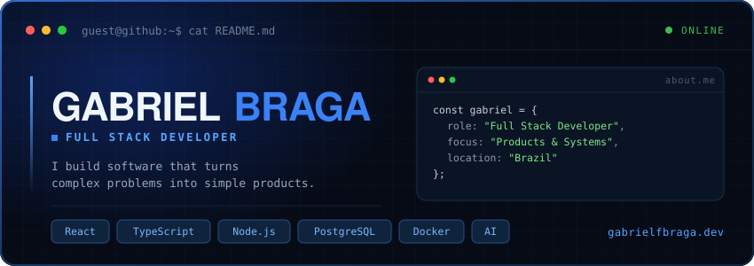

  <a href="https://gabrielfbraga.dev" style="display:inline-flex;align-items:center;gap:6px;padding:8px 14px;border:1px solid #d4d4d8;border-radius:9999px;text-decoration:none;color:inherit;background:#fff;">
    <svg width="14" height="14" viewBox="0 0 24 24" fill="none" xmlns="http://www.w3.org/2000/svg" aria-hidden="true">
      <path d="M3 21h18" stroke="currentColor" stroke-width="2" stroke-linecap="round" />
      <path d="M5 21V7l7-4 7 4v14" stroke="currentColor" stroke-width="2" stroke-linecap="round" stroke-linejoin="round" />
    </svg>
    Portfolio
  </a>
  &nbsp;
  <a href="https://linkedin.com/in/gabrielfbraga" style="display:inline-flex;align-items:center;gap:6px;padding:8px 14px;border:1px solid #d4d4d8;border-radius:9999px;text-decoration:none;color:inherit;background:#fff;">
    <svg width="14" height="14" viewBox="0 0 24 24" fill="none" xmlns="http://www.w3.org/2000/svg" aria-hidden="true">
      <path d="M16 8a6 6 0 0 1 6 6v6h-4v-6a2 2 0 0 0-4 0v6h-4V8h4v2a4 4 0 0 1 2-2Z" fill="currentColor" />
      <rect x="2" y="8" width="4" height="12" rx="1" fill="currentColor" />
      <circle cx="4" cy="4" r="2" fill="currentColor" />
    </svg>
    LinkedIn
  </a>
  &nbsp;
  <a href="https://github.com/gaabrielbraga" style="display:inline-flex;align-items:center;gap:6px;padding:8px 14px;border:1px solid #d4d4d8;border-radius:9999px;text-decoration:none;color:inherit;background:#fff;">
    <svg width="14" height="14" viewBox="0 0 24 24" fill="none" xmlns="http://www.w3.org/2000/svg" aria-hidden="true">
      <path d="M12 2a10 10 0 0 0-3.16 19.49c.5.09.68-.22.68-.48v-1.68c-2.78.6-3.37-1.17-3.37-1.17-.46-1.17-1.12-1.48-1.12-1.48-.92-.63.07-.62.07-.62 1.02.07 1.56 1.05 1.56 1.05.9 1.55 2.35 1.1 2.92.84.09-.66.35-1.1.63-1.35-2.22-.25-4.55-1.11-4.55-4.95 0-1.09.39-1.98 1.04-2.68-.1-.25-.45-1.27.1-2.64 0 0 .84-.27 2.75 1.03A9.5 9.5 0 0 1 12 7.07c.85 0 1.71.11 2.51.32 1.91-1.3 2.75-1.03 2.75-1.03.55 1.37.2 2.39.1 2.64.65.7 1.04 1.59 1.04 2.68 0 3.85-2.33 4.7-4.56 4.95.36.31.68.92.68 1.86v2.76c0 .26.18.58.69.48A10 10 0 0 0 12 2Z" fill="currentColor" />
    </svg>
    GitHub
  </a>

