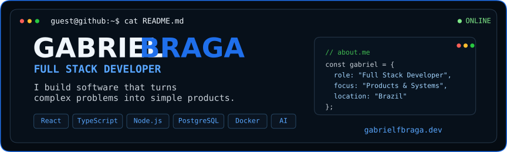
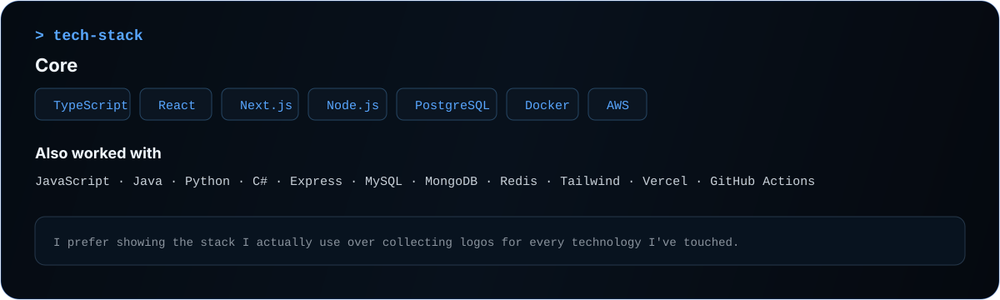
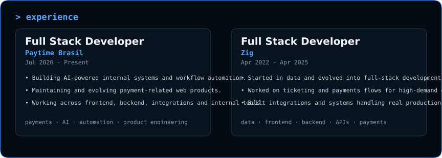
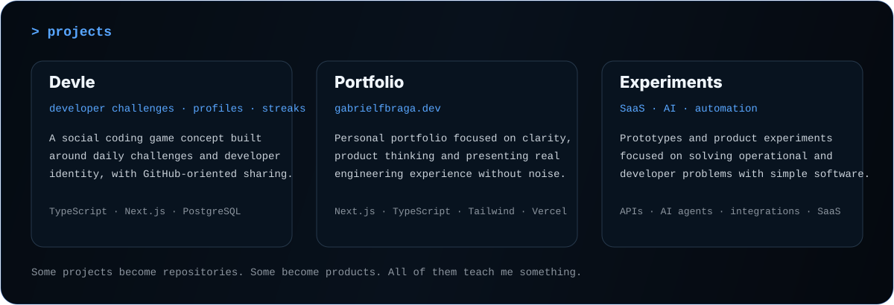
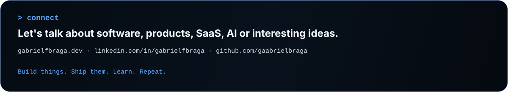

  

 

  <a href="https://gabrielfbraga.dev"><b>Portfolio</b></a>
  &nbsp;•&nbsp;
  <a href="https://www.linkedin.com/in/gabrielfbraga"><b>LinkedIn</b></a>
  &nbsp;•&nbsp;
  <a href="https://github.com/gaabrielbraga"><b>GitHub</b></a>

 

  

 

  

 

  

 

  

 

## GitHub

  
  

  

 

  

